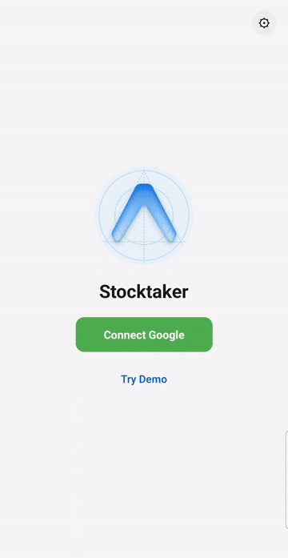

# Stocktaker

A mobile app (Expo / React Native) for physical stock checks. Scan each item's
barcode at a location, then submit which items were found to a shared master
inventory Google Sheet. See [`USER_MANUAL.md`](USER_MANUAL.md) for the end-user
walkthrough.

## Demo

[](docs/demo.mp4)

Build with `ENABLE_DEMO=1` (see `.env.local.example`) to show a **Try Demo**
button on the Landing screen. Tap it to run the whole flow (pick location,
simulate scans, Submit, Upload) against built-in sample data, with no Google
account or master sheet. Nothing is saved or sent anywhere. Upload opens the
system share sheet with the CSV, so the recording above skips it.

## Requirements

- Node 20+ and npm
- JDK 17 and the Android SDK (platform 36) for local Android builds
- A Google Cloud project with the Sheets and Drive APIs enabled
- A master Google Sheet (see below)

> Expo Go is not supported — the app uses native modules (Google Sign-In), so it
> runs as a custom dev-client build. See [`ANDROID_DEV.md`](ANDROID_DEV.md).

## Setup

```bash
npm install
cp .env.local.example .env.local   # then fill in the values below
```

`.env.local` is gitignored and read by `app.config.js` at build time.

| Variable | Purpose |
| --- | --- |
| `ANDROID_PACKAGE_NAME` | Application id / bundle id. Change it from the `com.anonymous.stocktaker` default to your own. |
| `APP_NAME` | Display name (default `Stocktaker`). |
| `APP_ICON` | Path to the launcher icon (default `./assets/logo-override.png`). |
| `GOOGLE_MASTER_SHEET_ID` | Id of the master inventory sheet (the long id in its URL). |
| `GOOGLE_REPORT_FOLDER_ID` | Drive folder that uploaded CSV reports are saved into. |
| `GOOGLE_IOS_CLIENT_ID` | iOS OAuth client id (only for iOS builds). |
| `GDRIVE_*` | Only for `npm run release` — see [`RELEASE.md`](RELEASE.md). |

### Google Cloud

1. Enable the **Google Sheets API** and **Google Drive API**.
2. Create an **Android** OAuth client using your `ANDROID_PACKAGE_NAME` and the
   SHA-1 of the keystore you sign with. (Release builds currently sign with the
   debug keystore, so register that SHA-1 too.)
3. Add every user as a test user (or publish the consent screen). The app asks
   for the Sheets and full `drive` scopes.

### Master sheet

The first sheet tab needs a header row containing these columns (any order):

`Location`, `Barcode`, `Item Name`, `Description`, `Updated At`, `Updated By`,
`Current Location`

One row per item. An "Unknown Barcodes" tab is created automatically on first
submit. Sample data lives in [`test-data/`](test-data).

## Running

```bash
npx expo run:android   # build + install a dev client on a connected device
npx expo start         # Metro only, once the dev client is installed
npm test               # jest
npx tsc --noEmit       # type check
```

## Private branding

The committed `assets/` contain generic placeholder icons. To build with your
own artwork without committing it, put replacements in `branding/` (gitignored)
using the same filenames (`icon.png`, `logo-override.png`,
`android-icon-foreground.png`, `android-icon-background.png`,
`android-icon-monochrome.png`) and run:

```bash
scripts/apply-branding.sh          # copy over assets/ and hide the changes from git
scripts/apply-branding.sh --undo   # restore the placeholders
```

Set `APP_NAME`, `ANDROID_PACKAGE_NAME` and `APP_ICON` in `.env.local` as needed.

## Releasing

`npm run release -- <version>` bumps the version, builds the APK and slide deck
and (optionally) uploads them to Drive. See [`RELEASE.md`](RELEASE.md). Release
APKs are signed with the debug keystore — fine for sideloading, **not** for the
Play Store. Generate your own keystore before publishing there.

## License

[MIT](LICENSE)
